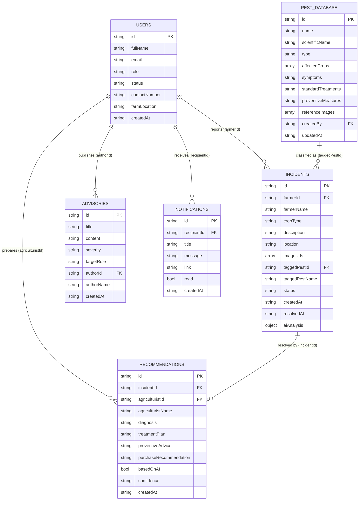

# AgriCare — Entity Relationship Diagram (ERD)

This document contains the logical ERD for the AgriCare Pest & Disease Reporting and Advisory System. It is provided in two text formats you can paste into online diagram tools:

- **Mermaid `erDiagram`** — paste into [mermaid.live](https://mermaid.live), GitHub Markdown, or any Mermaid renderer.
- **DBML** — paste into [dbdiagram.io](https://dbdiagram.io) (import → DBML) to generate a swimlane-friendly diagram.

> **Note on the data store:** AgriCare uses Cloud Firestore (NoSQL document database) with Supabase Storage for images. Firestore has no enforced foreign keys, so relationships below are logical — documents store the related document's ID (for example `incidents.farmerId` references `users.id`). The `aiAnalysis` object is **embedded** inside each incident document, not a separate collection.

---

## Mermaid ERD



---

## DBML (for dbdiagram.io)

```dbml
Table users {
  id varchar [pk]
  fullName varchar
  email varchar
  role varchar // admin | agriculturist | farmer
  status varchar // pending | approved | rejected
  contactNumber varchar
  farmLocation varchar
  createdAt timestamp
}

Table incidents {
  id varchar [pk]
  farmerId varchar
  farmerName varchar
  cropType varchar
  description text
  location varchar
  imageUrls text[] // Supabase Storage URLs or inline data
  taggedPestId varchar
  taggedPestName varchar
  status varchar // pending | under_review | resolved
  createdAt timestamp
  resolvedAt timestamp
  aiAnalysis json // embedded AI result
}

Table recommendations {
  id varchar [pk]
  incidentId varchar
  agriculturistId varchar
  agriculturistName varchar
  diagnosis text
  treatmentPlan text
  preventiveAdvice text
  purchaseRecommendation text
  basedOnAI boolean
  confidence varchar
  createdAt timestamp
}

Table pest_database {
  id varchar [pk]
  name varchar
  scientificName varchar
  type varchar // pest | disease
  affectedCrops text[]
  symptoms text
  standardTreatments text
  preventiveMeasures text
  referenceImages text[]
  createdBy varchar
  updatedAt timestamp
}

Table advisories {
  id varchar [pk]
  title varchar
  content text
  severity varchar // info | warning | urgent
  targetRole varchar // all | farmer | agriculturist
  authorId varchar
  authorName varchar
  createdAt timestamp
}

Table notifications {
  id varchar [pk]
  recipientId varchar
  title varchar
  message text
  link varchar
  read boolean
  createdAt timestamp
}

Ref: incidents.farmerId > users.id
Ref: incidents.taggedPestId > pest_database.id
Ref: recommendations.incidentId > incidents.id
Ref: recommendations.agriculturistId > users.id
Ref: advisories.authorId > users.id
Ref: notifications.recipientId > users.id
Ref: pest_database.createdBy > users.id
```
