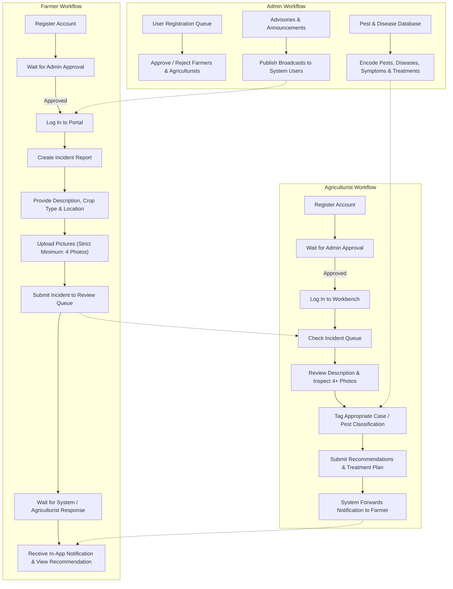

# Mobile-Based Pest and Disease Reporting and Advisory System

## 1. Project Overview
The **Mobile-Based Pest and Disease Reporting and Advisory System** is a mobile-first web application designed to connect Farmers, Agriculturists, and Administrators for fast pest and disease identification, expert recommendations, and agricultural advisories.

- **Frontend & Deployment**: Next.js (App Router), React, Tailwind CSS, Lucide Icons, hosted on Vercel.
- **Backend & Database**: Firebase (Firebase Auth, Cloud Firestore) for accounts and text/data, plus Supabase Storage for incident image uploads, with integrated local demo/mock support for immediate offline testing.
- **Source Specification**: Derived directly from the process flow in `web flow.pdf`.

---

## 2. User Roles & Core Workflows

### 2.1 Farmer Workflow
1. **Registration & Approval**: Farmer registers an account and waits for Admin approval before accessing the dashboard.
2. **Log-in**: Authenticates via credentials.
3. **Report Incident**:
   - Provide crop type and detailed description of symptoms.
   - Farm location (Barangay, Municipality, or GPS coordinates).
   - **Upload Pictures**: Enforces a strict validation requiring **at least 4 pictures** per incident.
4. **Tracking & Advisory**:
   - Incident enters the review queue with status `Pending Review`.
   - Farmer views real-time status updates and notifications.
   - Once reviewed, Farmer accesses the Agriculturist's diagnosis, chemical/cultural treatment steps, and preventive measures.
   - Receives general advisories and announcements published by the Admin.

### 2.2 Agriculturist Workflow
1. **Registration & Approval**: Agriculturist registers and awaits Admin approval.
2. **Log-in**: Authenticates into the Agriculturist Workbench.
3. **Incident Triage Queue**:
   - Checks the list of reported incidents.
   - Filters by review status, crop type, or date.
4. **Case Review & Inspection**:
   - Reviews farmer description, symptoms, and location.
   - Inspects the full gallery of 4+ high-resolution uploaded images with zoom/lightbox.
5. **Tag Case**:
   - Selects and tags the appropriate pest or disease diagnosis from the encoded Pest Database.
6. **Submit Recommendation**:
   - Fills out actionable treatment recommendations (e.g., immediate control methods, dosage, safety precautions, cultural practices).
   - Submits the recommendation, transitioning the case status to `Resolved`.
7. **Farmer Notification**:
   - The system automatically triggers an in-app notification forwarding the recommendation directly to the reporting Farmer.

### 2.3 Admin Workflow
1. **User Approval & Management**:
   - Reviews registration requests for both Farmers and Agriculturists.
   - Approves or rejects accounts to ensure only authorized users access the platform.
2. **Pest & Disease Knowledge Base Encoding**:
   - Encodes and maintains the official catalog of pests and diseases.
   - Specifies scientific names, affected crops, characteristic symptoms, standard treatments, and reference photos.
3. **Advisories & Announcements**:
   - Composes community-wide or targeted agricultural alerts and seasonal outbreak warnings.
   - Broadcasts advisories to Farmers and Agriculturists.
4. **System Overview**:
   - Tracks incident resolution rates, frequent pest occurrences, and user statistics.

---

## 3. Process Flowchart

---

## 4. Data Architecture & Schema

### 4.1 Collections (Firestore / Data Models)

#### `users`
- `id` (string, primary key / Firebase Auth UID)
- `fullName` (string)
- `email` (string)
- `role` (`"admin"` | `"agriculturist"` | `"farmer"`)
- `status` (`"pending"` | `"approved"` | `"rejected"`)
- `contactNumber` (string)
- `farmLocation` (string, barangay/municipality)
- `createdAt` (timestamp)

#### `pest_database`
- `id` (string)
- `name` (string, e.g. "Fall Armyworm", "Rice Blast")
- `scientificName` (string)
- `type` (`"pest"` | `"disease"`)
- `affectedCrops` (array of strings)
- `symptoms` (string)
- `standardTreatments` (string)
- `preventiveMeasures` (string)
- `referenceImages` (array of image URLs)
- `updatedAt` (timestamp)

#### `incidents`
- `id` (string)
- `farmerId` (string, reference to users)
- `farmerName` (string)
- `cropType` (string)
- `description` (string)
- `location` (string)
- `imageUrls` (array of strings, **must contain at least 4 items**)
- `taggedPestId` (string, nullable, reference to pest_database)
- `taggedPestName` (string, nullable)
- `status` (`"pending"` | `"under_review"` | `"resolved"`)
- `createdAt` (timestamp)
- `resolvedAt` (timestamp, nullable)

#### `recommendations`
- `id` (string)
- `incidentId` (string, reference to incidents)
- `agriculturistId` (string, reference to users)
- `agriculturistName` (string)
- `diagnosis` (string)
- `treatmentPlan` (string)
- `preventiveAdvice` (string)
- `createdAt` (timestamp)

#### `advisories`
- `id` (string)
- `title` (string)
- `content` (string)
- `severity` (`"info"` | `"warning"` | `"urgent"`)
- `targetRole` (`"all"` | `"farmer"` | `"agriculturist"`)
- `authorId` (string, reference to users)
- `createdAt` (timestamp)

#### `notifications`
- `id` (string)
- `recipientId` (string, reference to users)
- `title` (string)
- `message` (string)
- `link` (string, e.g., `/farmer/incident/{id}`)
- `read` (boolean)
- `createdAt` (timestamp)

---

## 5. Screen & Feature Specifications

### 5.1 Authentication & Gating
- **Role-based Registration**: Fields for Full Name, Email, Password, Contact Number, Address, and Role selection (`Farmer` or `Agriculturist`).
- **Approval Gate**: Once registered, accounts enter `pending` state and display a `Waiting for Admin Approval` screen upon login attempt until verified.
- **Admin Seed/Bootstrap**: First admin account can be seeded or initialized to approve pending members.

### 5.2 Farmer Portal (Mobile-First Layout)
- **Dashboard**: Quick stats (Active Reports, Resolved Cases, Recent Advisories) and action button `+ Report New Incident`.
- **New Incident Form**:
  - Crop Selection (Rice, Corn, Vegetables, Fruit Trees, etc.).
  - Observed Symptoms & Onset Details.
  - Location input (GPS button or manual Barangay entry).
  - **4-Photo Upload Grid**: Drag-and-drop or camera capture interface with counter indicator (`X of 4 photos uploaded`). Submit button remains disabled until at least 4 valid photos are staged.
- **Incident Detail View**: Displays original photos, submission details, review timeline, and Agriculturist's full recommendation once available.
- **Advisory Feed**: Community announcements and pest outbreak warnings.

### 5.3 Agriculturist Workbench
- **Triage Incident Queue**: Tabbed list (`Pending Review`, `Resolved`, `All`).
- **Case Review Panel**:
  - Image gallery with full-screen zoom to examine pest/disease lesions or insects.
  - Farmer incident background.
- **Diagnosis & Tagging**:
  - Dropdown/autocomplete linked to the Pest Database (auto-fills reference symptoms and recommended practices).
  - Editable treatment prescription textarea.
- **Submit Action**: Saves the recommendation, marks the incident as `Resolved`, and creates a notification entry for the farmer.

### 5.4 Admin Control Center
- **User Verification**: Table/cards of pending accounts with `Approve` and `Reject` one-click actions.
- **Pest Knowledge Base Encoder**: Form to add/edit pests and diseases with photos, affected crops, symptoms, and chemical/organic controls.
- **Advisory Publisher**: Editor to broadcast new notices with severity tags (`Info`, `Warning`, `Urgent`).

---

## 6. Project Technology & Setup Summary

- **Framework**: Next.js 14+ (App Router, TypeScript)
- **Styling**: Tailwind CSS, Mobile-Responsive navigation bar and drawer
- **Icons**: Lucide React
- **Services**:
  - Firebase Authentication
  - Cloud Firestore (text/data only)
  - Supabase Storage (incident images; URLs stored back in Firestore)
  - Local Demo Storage Adapter (allows full interaction prior to entering live Firebase/Supabase API keys)
- **Deployment**: Vercel ready via standard GitHub/Vercel deployment pipeline.
